# CCDVI Drive (offline)

**Repositório local de documentos de apoio da operação DVI**, baseado no **Nextcloud** (software livre). Funciona
somente na rede local, sem internet, e roda no mesmo servidor Linux do
[Sistema DVI Offline](https://github.com/eduardoandradej/ccdvi-sistema-offline).

> [!IMPORTANT]
> **Dados de casos NÃO ficam aqui.** Fichas AM/PM, entrevistas, fotografias, documentos de desaparecidos e
> comparações são registrados somente no Sistema DVI, que tem controle por perfil, verificação de integridade e
> auditoria. O Drive guarda formulários em branco, manuais, procedimentos, escalas, atas e relatórios administrativos.


## O que já vem configurado

| Item | Configuração |
|---|---|
| Operação sem internet | Loja de aplicativos, verificação de atualizações e aplicativos que acessam a internet desativados |
| Idioma | Português do Brasil |
| Grupos | `DVI-Todos`, `DVI-Comando`, `DVI-AnteMortem`, `DVI-PostMortem`, `DVI-TIC` |
| Pastas | **Formulários e Referências** (somente leitura, para todos), **Geral** (todos), **Comando**, **Ante Mortem**, **Post Mortem** e **TIC** (cada uma só para sua equipe) |
| Compartilhamento | Links públicos, recompartilhamento e federação com servidores externos desativados |
| Política de uso | Arquivo `LEIA-ME_Politica_de_Uso.txt` em cada pasta e na pasta pessoal de todo usuário, e aviso na tela de login |
| Edição no navegador | Não incluída, por decisão de projeto: evita planilhas de casos fora do Sistema DVI. Os arquivos são baixados, editados no computador e enviados de volta, com histórico de versões |

| Pastas da equipe (usuário da Base PM) | Formulários: somente leitura |
|---|---|
|  |  |

## Recursos

Telas capturadas da instalação de validação, com usuários e documentos fictícios.

### Para as equipes

| Visualizar formulários sem baixar | Política de uso em todas as pastas |
|---|---|
| 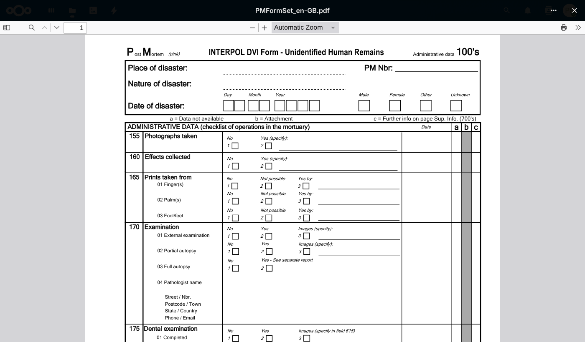 | 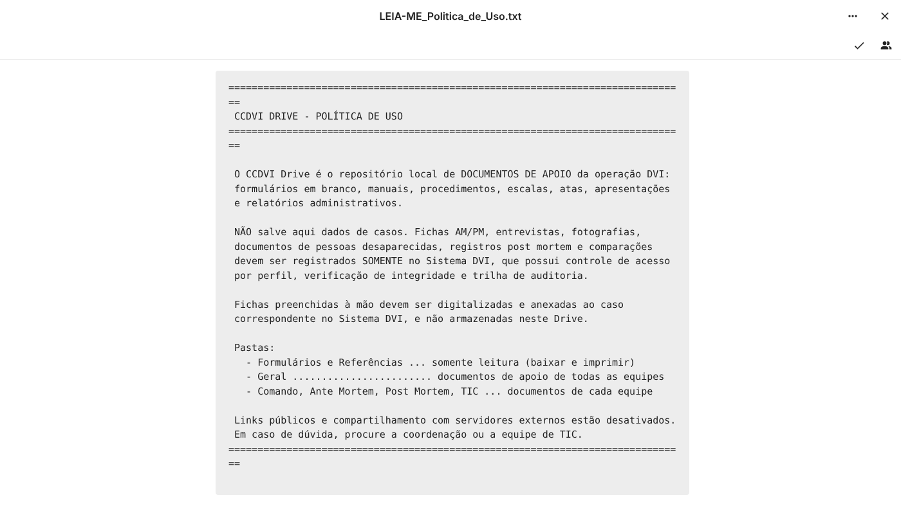 |
| **Compartilhamento: quem acessa e o que é permitido** | **Histórico de versões de cada arquivo** |
| 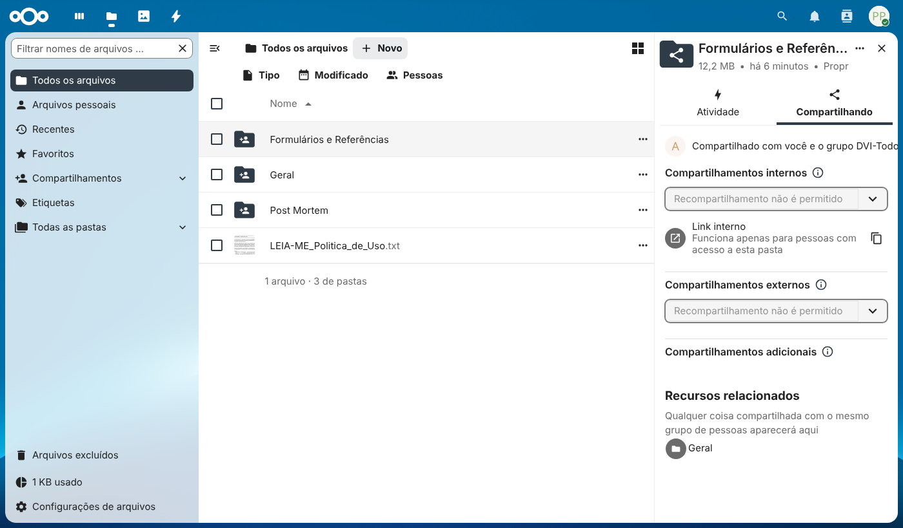 | 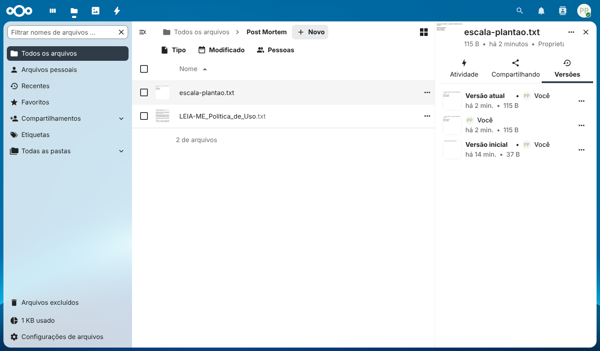 |
| **Atividades: quem criou, alterou ou excluiu** | **Busca por nome de arquivo** |
| 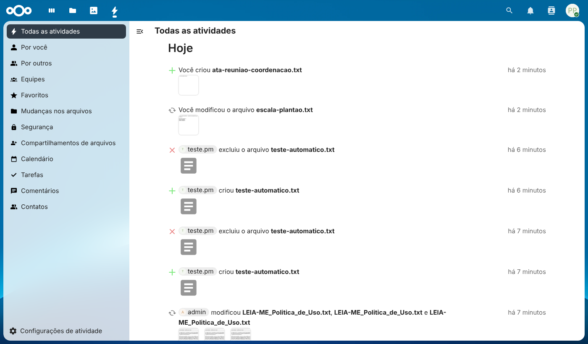 | 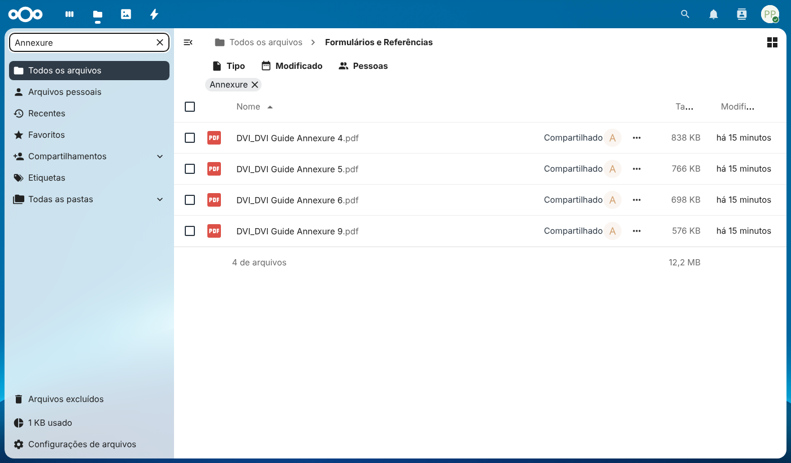 |
| **Segurança da conta: troca de senha e sessões** | **Uso em tablet** |
| 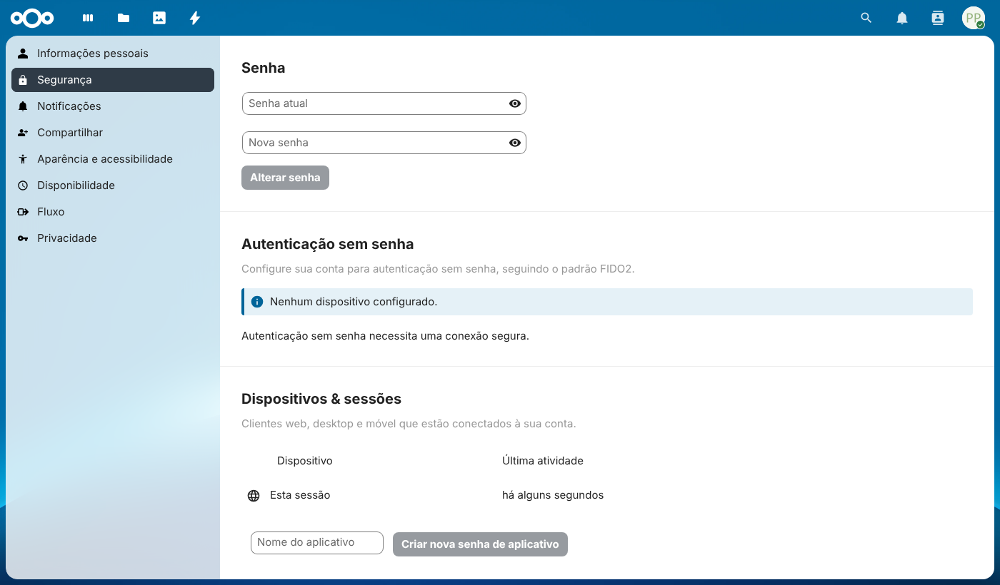 | 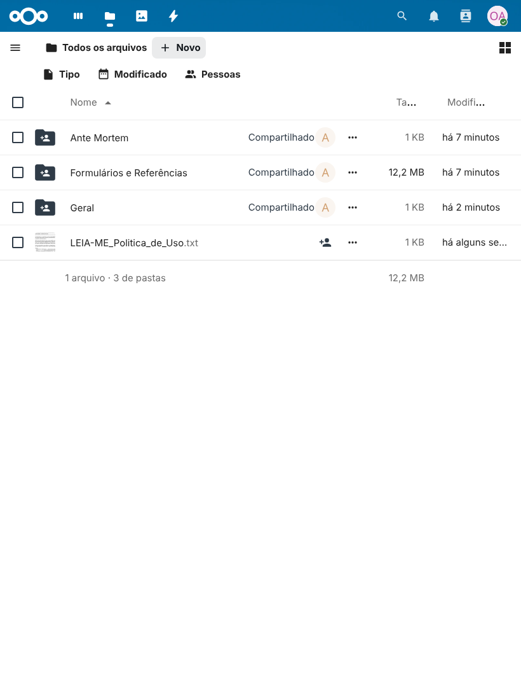 |

### Para a administração (TIC)

| Contas e grupos por equipe | Política de compartilhamento aplicada |
|---|---|
| 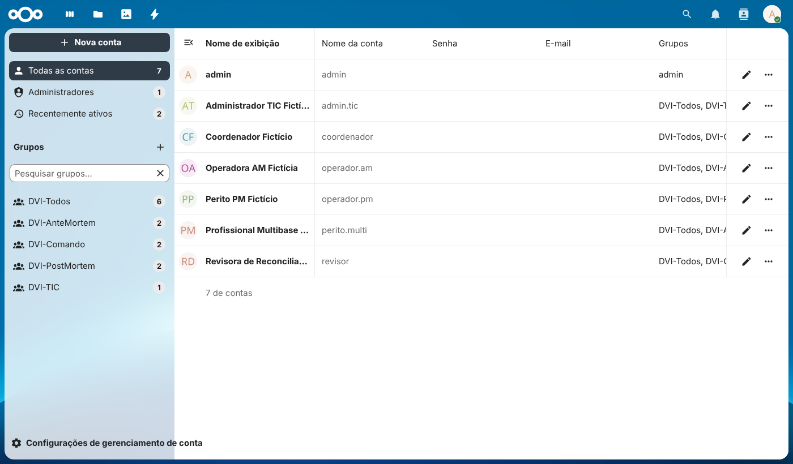 | 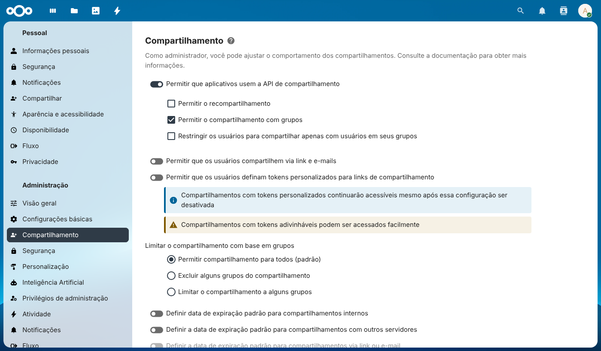 |

## Arquitetura

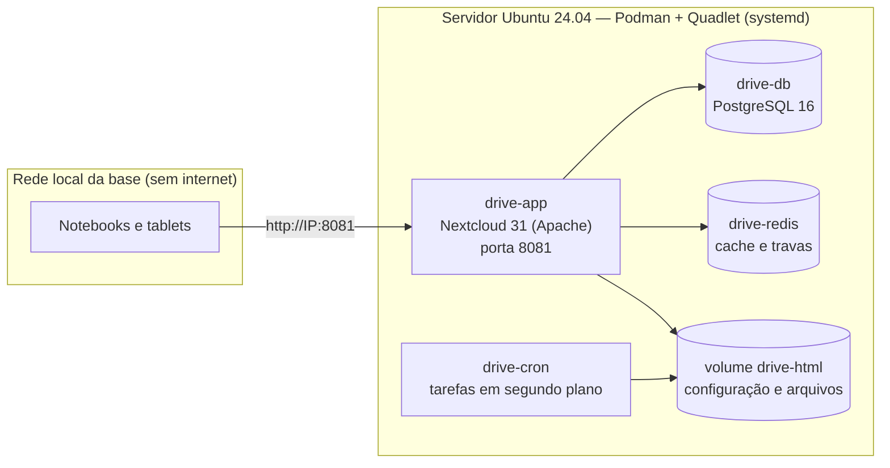

| Serviço no mesmo servidor | Porta |
|---|---|
| Sistema DVI Offline (execução nativa de laboratório) | 5173 |
| **CCDVI Drive** | **8081** |

Versões fixadas: Nextcloud **31.0.14**, PostgreSQL **16.15**, Redis **7.4.11** (imagens oficiais).

## Preparação do servidor e ordem recomendada

Este projeto foi planejado para funcionar **no mesmo Ubuntu Server 24.04 LTS** do Sistema DVI Offline, mas utiliza banco de dados, serviços e backups próprios. O Drive é destinado exclusivamente a **documentos de apoio**.

1. **Preparar a VM Ubuntu no Rocky Linux/KVM**, quando necessário: [script e runbook KVM no repositório do Sistema DVI](https://github.com/eduardoandradej/ccdvi-sistema-offline/tree/main/infra/kvm).
2. **Instalar o Sistema DVI Offline**: [repositório e runbook do Sistema](https://github.com/eduardoandradej/ccdvi-sistema-offline).
3. **Instalar o CCDVI Drive Offline**: siga o [Runbook de Instalação e Operação — CCDVI Drive](Runbook_Instalacao_Ubuntu_CCDVI_Drive.txt).

> O provisionamento da VM acontece **no hospedeiro Rocky Linux**; os comandos de instalação do Drive acontecem **dentro da VM Ubuntu**. Não execute novamente o script de criação da VM em uma máquina já instalada.

## Instalação do CCDVI Drive — Ubuntu Server 24.04 LTS

O roteiro completo, incluindo firewall, testes, backup, restauração e instalação sem internet, está no **[Runbook_Instalacao_Ubuntu_CCDVI_Drive.txt](Runbook_Instalacao_Ubuntu_CCDVI_Drive.txt)**.

### 1. Instalar pré-requisitos

```bash
sudo apt update
sudo apt install -y podman git curl
podman --version
ls -l /usr/libexec/podman/quadlet
```

### 2. Clonar o repositório (somente na primeira instalação)

```bash
cd ~
git clone https://github.com/eduardoandradej/ccdvi-drive-offline.git
cd ccdvi-drive-offline
```

Se o projeto já estiver clonado, não clone de novo: confira `git status` e, se estiver limpo, use `git pull --ff-only origin main`.

### 3. Preparar usuários (opcional)

```bash
cp config/usuarios.exemplo.csv config/usuarios.csv
nano config/usuarios.csv
```

O CSV de usuários é uma configuração **local**: não envie listas reais de pessoas ao GitHub. O modelo contém apenas informações fictícias.

### 4. Instalar e validar

Se o Sistema DVI estiver instalado e seus documentos de referência estiverem disponíveis:

```bash
sudo scripts/instalar.sh --usuarios config/usuarios.csv \
  --formularios ~/ccdvi-sistema-offline/docs
sudo scripts/testar.sh
```

Ou, para uma instalação inicial sem lista de usuários e sem importar formulários:

```bash
sudo scripts/instalar.sh
sudo scripts/testar.sh
```

A aplicação ficará disponível em `http://IP-DO-UBUNTU:8081`. A senha do administrador é gerada e armazenada em `/etc/ccdvi-drive/admin.senha` com acesso restrito ao administrador do servidor.

> **Não confundir:** `sudo scripts/instalar.sh` é uma tarefa de instalação/configuração, **não** um comando que precisa ficar aberto no terminal. O Drive passa a funcionar como serviços systemd gerados pelo Podman/Quadlet.

## Operação dos serviços — systemd / Quadlet

O Sistema DVI usa o serviço `ccdvi.service`. O **Drive não precisa de um serviço adicional `ccdvi-drive.service`**: seu instalador já prepara quatro serviços de sistema independentes.

| Componente | Unidade systemd | Função |
|---|---|---|
| Banco de dados | `drive-db.service` | PostgreSQL do Drive |
| Cache | `drive-redis.service` | Redis |
| Aplicação | `drive-app.service` | Nextcloud / Apache |
| Tarefas agendadas | `drive-cron.service` | Rotinas do Nextcloud |

```bash
# Consultar o estado
sudo systemctl status drive-db drive-redis drive-app drive-cron --no-pager

# Iniciar na ordem das dependências
sudo systemctl start drive-db drive-redis drive-app drive-cron

# Parar na ordem inversa
sudo systemctl stop drive-cron drive-app drive-redis drive-db

# Reiniciar apenas o Nextcloud
sudo systemctl restart drive-app

# Acompanhar os logs (Ctrl+C apenas interrompe a visualização)
sudo journalctl -u drive-app -f

# Listar contêineres em execução
sudo podman ps
```

Os arquivos de origem do Quadlet estão em `deploy/quadlet/`; após a instalação, são copiados para `/etc/containers/systemd/`. **Valide a inicialização automática após um reboot** seguindo a seção 9 do runbook; esse ponto não foi confirmado no ambiente original de testes.

## Backup e manutenção

Antes de atualizar ou modificar o ambiente, gere um backup dos dados e mantenha uma cópia em mídia protegida:

```bash
sudo scripts/backup.sh /srv/backups/drive
```

A restauração **substitui** o conteúdo atual e deve ser feita somente conforme a seção 10 do runbook. O backup pode conter credenciais internas e deve ter acesso restrito, preferencialmente com criptografia.

Para atualizar a cópia do repositório (arquivos de documentação e scripts), primeiro verifique alterações locais:

```bash
cd ~/ccdvi-drive-offline
git status
git pull --ff-only origin main
```

Atualizar os arquivos do Git **não atualiza automaticamente** os contêineres nem aplica necessariamente novas unidades Quadlet. Para isso, leia as notas da versão e o runbook correspondente. Não reexecute comandos destrutivos sem backup.

## Scripts

| Script | Função |
|---|---|
| `scripts/instalar.sh` | Gera senhas, cria segredos do Podman, instala as unidades Quadlet, sobe os serviços e aplica a configuração |
| `scripts/configurar.sh` | Política, grupos, pastas, usuários (`--usuarios`) e formulários (`--formularios`); pode ser reexecutado |
| `scripts/testar.sh` | 19 verificações automáticas: serviço, operação sem internet, permissões por equipe e bloqueio de links públicos |
| `scripts/backup.sh` | Banco + configuração + arquivos, com manifesto SHA-256; criptografia GPG opcional |
| `scripts/restaurar.sh` | Restaura um backup na mesma máquina ou em uma instalação nova |
| `scripts/desinstalar.sh` | Remove os serviços (mantém os dados); `--tudo` apaga também dados e senhas |

## Validação

Executado em **Ubuntu 24.04.5 LTS com Podman 4.9.3** (o mesmo do repositório do Ubuntu), em modo rootful:

| Teste | Resultado |
|---|---|
| Unidades Quadlet processadas pelo gerador oficial do Podman | Sem erros |
| Instalação do zero com usuários e formulários | Concluída |
| `scripts/testar.sh` | 19 verificações aprovadas |
| Reexecução da configuração (idempotência) | Sem duplicações |
| Backup → apagar tudo → instalar com senhas novas → restaurar | Usuários, arquivos e senhas recuperados; testes aprovados |

O ambiente de validação não tinha systemd como processo principal. Por isso, os contêineres foram iniciados com
exatamente os comandos `podman run` que o Quadlet gera a partir destas unidades. O início automático pelo systemd no
boot deve ser confirmado na primeira instalação no servidor (passo 9 do runbook).

## Estrutura

```
config/          modelo de configuração (drive.env.example) e usuários de exemplo (fictícios)
deploy/quadlet/  unidades Quadlet: rede, volumes e os contêineres db, redis, app e cron
politica/        texto da política de uso distribuído nas pastas
scripts/         instalar, configurar, testar, backup, restaurar, desinstalar
docs/imagens/    telas capturadas da instalação de validação
Runbook_Instalacao_Ubuntu_CCDVI_Drive.txt   instalação, operação, backup e recuperação
```
