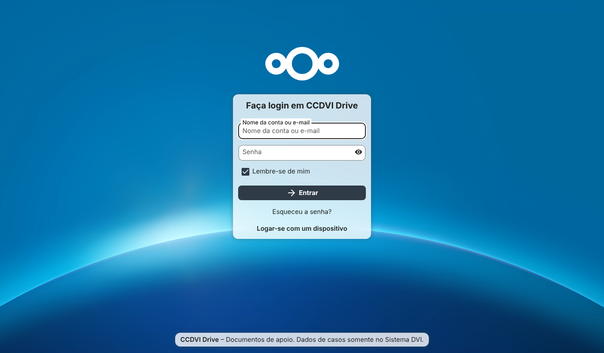
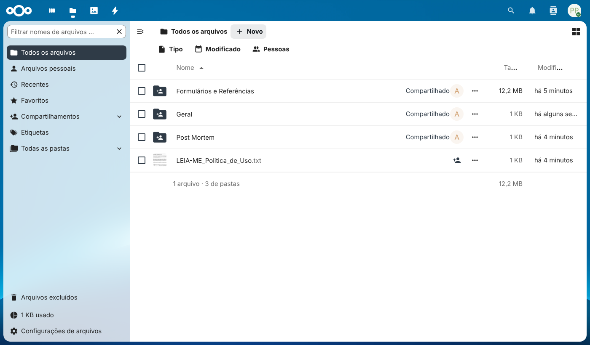
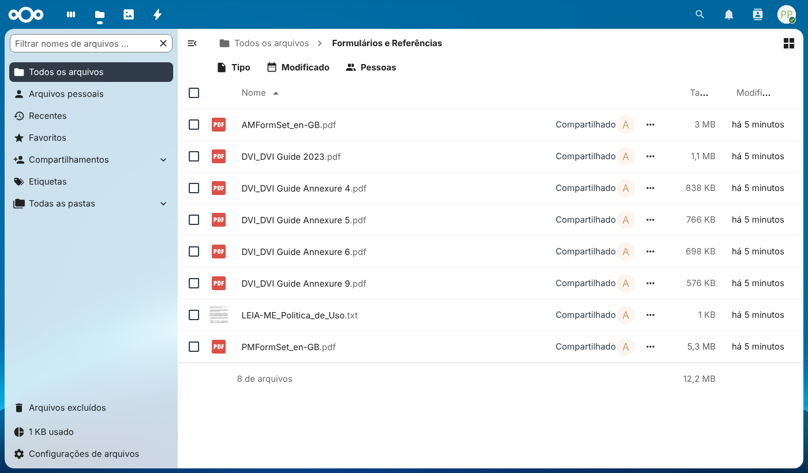
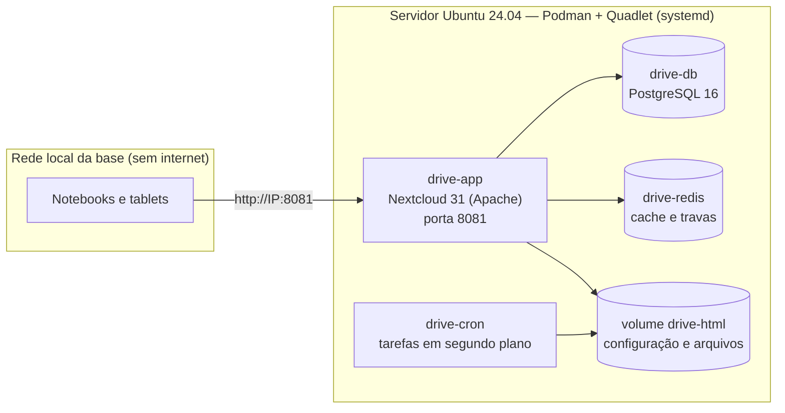

# CCDVI Drive (offline)

**Repositório local de documentos de apoio da operação DVI**, baseado no **Nextcloud** (software livre). Funciona
somente na rede local, sem internet, e roda no mesmo servidor Linux do
[Sistema DVI Offline](https://github.com/eduardoandradej/ccdvi-sistema-offline).

> [!IMPORTANT]
> **Dados de casos NÃO ficam aqui.** Fichas AM/PM, entrevistas, fotografias, documentos de desaparecidos e
> comparações são registrados somente no Sistema DVI, que tem controle por perfil, verificação de integridade e
> auditoria. O Drive guarda formulários em branco, manuais, procedimentos, escalas, atas e relatórios administrativos.



## O que já vem configurado

| Item | Configuração |
|---|---|
| Operação sem internet | Loja de aplicativos, verificação de atualizações e aplicativos que acessam a internet desativados |
| Idioma | Português do Brasil |
| Grupos | `DVI-Todos`, `DVI-Comando`, `DVI-AnteMortem`, `DVI-PostMortem`, `DVI-TIC` |
| Pastas | **Formulários e Referências** (somente leitura, para todos), **Geral** (todos), **Comando**, **Ante Mortem**, **Post Mortem** e **TIC** (cada uma só para sua equipe) |
| Compartilhamento | Links públicos, recompartilhamento e federação com servidores externos desativados |
| Política de uso | Arquivo `LEIA-ME_Politica_de_Uso.txt` em cada pasta e na pasta pessoal de todo usuário, e aviso na tela de login |
| Edição no navegador | Não incluída, por decisão de projeto: evita planilhas de casos fora do Sistema DVI. Os arquivos são baixados, editados no computador e enviados de volta, com histórico de versões |

| Pastas da equipe (usuário da Base PM) | Formulários: somente leitura |
|---|---|
|  |  |

## Arquitetura



| Serviço no mesmo servidor | Porta |
|---|---|
| Sistema DVI (desenvolvimento / produção) | 5173 / 8080 |
| **CCDVI Drive** | **8081** |

Versões fixadas: Nextcloud **31.0.14**, PostgreSQL **16.15**, Redis **7.4.11** (imagens oficiais).

## Instalação

Passo a passo completo, com solução de problemas: **[Runbook_Instalacao_Ubuntu.txt](Runbook_Instalacao_Ubuntu.txt)**.

```bash
sudo apt install -y podman git
git clone https://github.com/eduardoandradej/ccdvi-drive-offline.git && cd ccdvi-drive-offline
cp config/usuarios.exemplo.csv config/usuarios.csv      # edite com os usuários reais
sudo scripts/instalar.sh --usuarios config/usuarios.csv --formularios ~/ccdvi-sistema-offline/docs
sudo scripts/testar.sh
```

## Scripts

| Script | Função |
|---|---|
| `scripts/instalar.sh` | Gera senhas, cria segredos do Podman, instala as unidades Quadlet, sobe os serviços e aplica a configuração |
| `scripts/configurar.sh` | Política, grupos, pastas, usuários (`--usuarios`) e formulários (`--formularios`); pode ser reexecutado |
| `scripts/testar.sh` | 19 verificações automáticas: serviço, operação sem internet, permissões por equipe e bloqueio de links públicos |
| `scripts/backup.sh` | Banco + configuração + arquivos, com manifesto SHA-256; criptografia GPG opcional |
| `scripts/restaurar.sh` | Restaura um backup na mesma máquina ou em uma instalação nova |
| `scripts/desinstalar.sh` | Remove os serviços (mantém os dados); `--tudo` apaga também dados e senhas |

## Validação

Executado em **Ubuntu 24.04.5 LTS com Podman 4.9.3** (o mesmo do repositório do Ubuntu), em modo rootful:

| Teste | Resultado |
|---|---|
| Unidades Quadlet processadas pelo gerador oficial do Podman | Sem erros |
| Instalação do zero com usuários e formulários | Concluída |
| `scripts/testar.sh` | 19 verificações aprovadas |
| Reexecução da configuração (idempotência) | Sem duplicações |
| Backup → apagar tudo → instalar com senhas novas → restaurar | Usuários, arquivos e senhas recuperados; testes aprovados |

O ambiente de validação não tinha systemd como processo principal. Por isso, os contêineres foram iniciados com
exatamente os comandos `podman run` que o Quadlet gera a partir destas unidades. O início automático pelo systemd no
boot deve ser confirmado na primeira instalação no servidor (passo 9 do runbook).

## Estrutura

```
config/          modelo de configuração (drive.env.example) e usuários de exemplo (fictícios)
deploy/quadlet/  unidades Quadlet: rede, volumes e os contêineres db, redis, app e cron
politica/        texto da política de uso distribuído nas pastas
scripts/         instalar, configurar, testar, backup, restaurar, desinstalar
docs/imagens/    telas capturadas da instalação de validação
```
